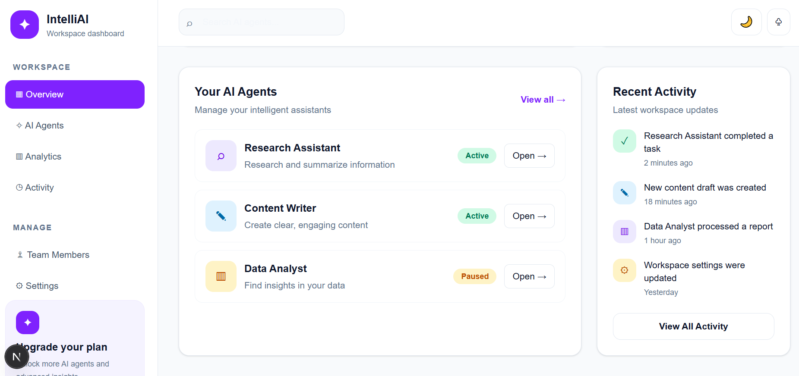
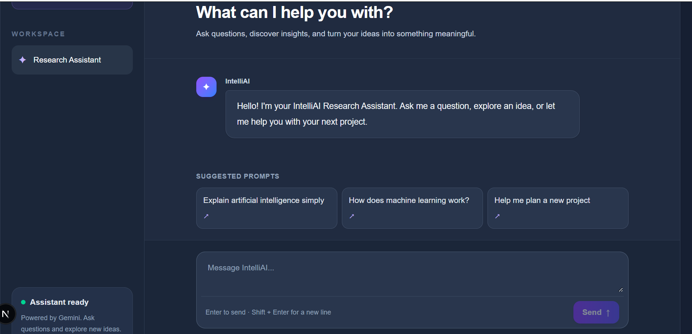
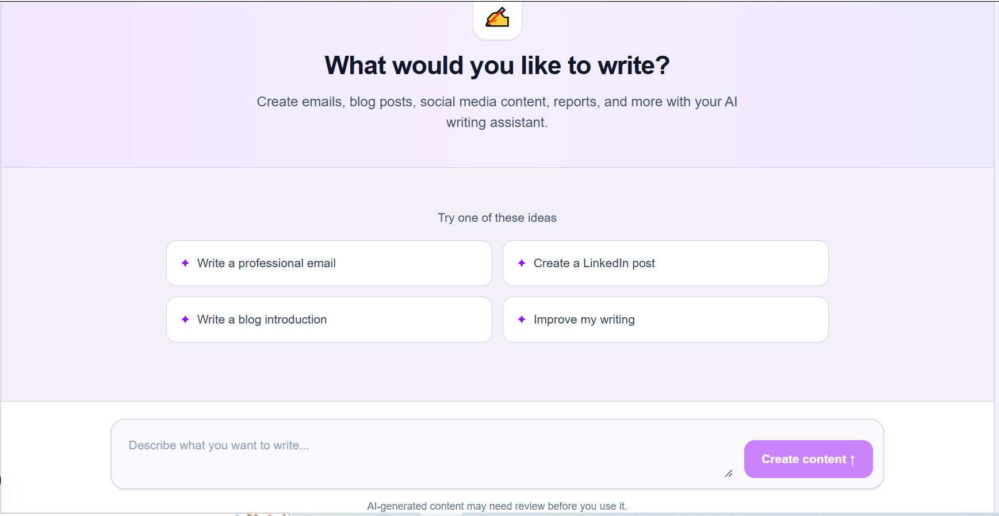
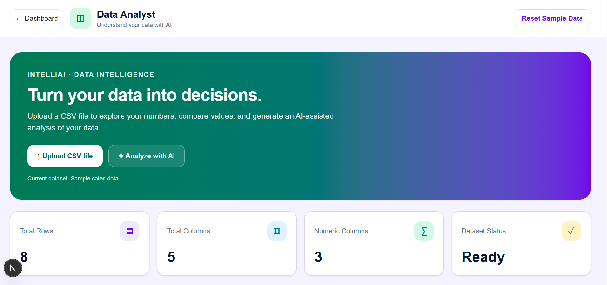

# IntelliAI Workspace Dashboard

An AI-powered workspace dashboard built with Next.js, TypeScript, and Tailwind CSS.

## Overview

IntelliAI is a responsive web application that brings multiple AI assistants together in one workspace. Users can access different tools through a single dashboard.

## Features

- **AI Workspace Dashboard** — A central place to access AI agents.
- **Research Assistant** — Ask questions and explore information with AI.
- **Content Writer** — Generate and improve written content.
- **Data Analyst** — Upload CSV data, review statistics, visualize numeric values, and request AI-powered analysis.
- **Responsive Design** — Layout designed for desktop, tablet, and mobile screens.
- **Gemini API Integration** — AI responses powered by Google's Gemini API.

## Tech Stack

- Next.js
- React
- TypeScript
- Tailwind CSS v4
- Google Gemini API
- Node.js and npm

## Getting Started

### 1. Install dependencies

```bash
npm install
```

### 2. Configure environment variables

Create a `.env.local` file in the project root and add your Gemini API key:

```env
GEMINI_API_KEY=your_gemini_api_key
```

Keep your API key private. Never commit `.env.local` or publish your actual key.

### 3. Start the development server

```bash
npm run dev
```

Open [http://localhost:3000](http://localhost:3000) in your browser.

### 4. Create a production build

```bash
npm run build
```

## Project Routes

| Page | Route |
|---|---|
| Dashboard | `/` |
| Research Assistant | `/agents/research` |
| Content Writer | `/agent/writer` |
| Data Analyst | `/agent/analyst` |
| Chat API | `/api/chat` |

## Author

**Samina Hasan**

Built as a learning and portfolio project.




